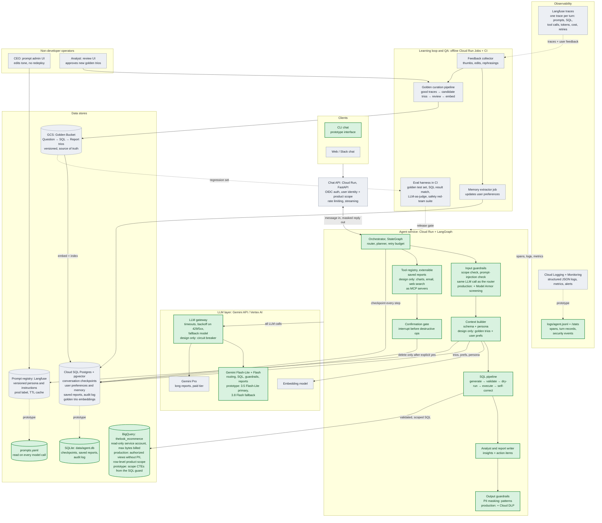
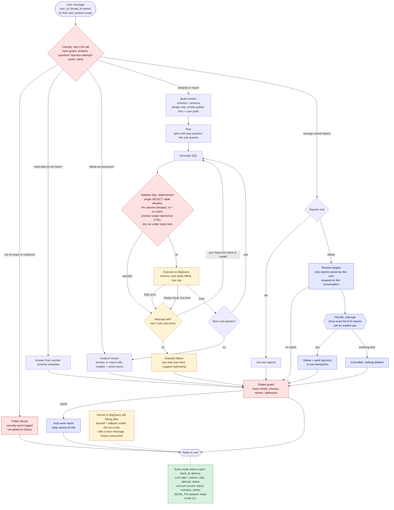

# High-Level Design: Data Analysis Chat Assistant

A chat agent that lets non-technical executives ask questions about sales data in plain
language, discuss the answers, and get reports with insights and action items. This
document describes the production design on Google Cloud and, for every part of it, what
the prototype in this repository already implements.

**How to read it.** Section 1 is the architecture, section 2 explains the technology
choices, section 3 has one subsection per requirement (1 to 8), sections 4 to 6 cover
error handling, observability and cost, and sections 7 to 9 list assumptions, open
questions and known limitations.

**Prototype vs production.** The prototype (Python, LangGraph, Gemini, BigQuery, SQLite,
CLI) implements requirements 2, 3, 5 and 7. Requirements 1, 4, 6 and 8 are designed here;
the prototype has the hooks for them (a context-building step, prompts loaded at runtime,
an offline-ready trace log). In the diagram, green blocks are built, grey blocks are
design only.

> **Verification status.** 117 automated tests run the real graph against fake Gemini and
> BigQuery clients, and the prototype was checked live against Gemini and BigQuery on
> 2026-10-08 and 2026-10-09 (README, "Verification" and "Example session"). The live checks
> found problems that the fakes could not show; they are fixed and described where relevant
> below. The fallback model answered live with the primary forced to fail, but a complete
> turn on it was not observed: it was overloaded (503) on at least one step every time.

---

## 1. Architecture

### 1.1 Building blocks

Source: [`docs/architecture.mmd`](architecture.mmd)



| Block | Production service | Prototype | Responsibility |
|---|---|---|---|
| Clients | Web chat, Slack app | CLI (`agent/cli.py`) | Send messages, render replies and confirmation prompts |
| Chat API | Cloud Run (FastAPI), Identity-Aware Proxy / OIDC | `--user` flag, thread ownership check | Authenticate the user, attach `user_id` and product scope, rate-limit, stream replies |
| Agent service | Cloud Run + LangGraph | `agent/graph.py`, `agent/nodes.py` | The state machine of one turn: guard, route, plan, SQL, answer, mask |
| LLM gateway | Gemini on Vertex AI behind a thin gateway module | `agent/llm.py` | Timeouts, backoff, fallback model, token accounting; circuit breaker in production |
| SQL guard | Same code + BigQuery authorized views, row-level access, policy tags | `agent/sql_guard.py` | Only read-only SELECTs over the user's scope, never PII columns |
| Warehouse | BigQuery, read-only service account | `agent/warehouse.py` over `agent/bq_client.py` | Dry-run cost check, bytes-billed cap, job timeout, row cap, retries |
| Operational store | Cloud SQL for PostgreSQL + pgvector | SQLite (`data/agent.db`) | Conversation checkpoints, saved reports, audit log, user preferences, golden-trio index |
| Prompt registry | Langfuse prompt management | `prompts.yaml`, re-read every turn | Persona and instructions, versioned, editable without a redeploy |
| Golden Bucket | Cloud Storage, object versioning | not built | Question -> SQL -> Report trios, source of truth |
| Observability | Cloud Logging + Monitoring, Langfuse traces | `logs/agent.jsonl`, `/stats` | Spans per node, a record per turn, metrics, alerts |
| Learning loop and QA | Cloud Run Jobs, Cloud Scheduler, Cloud Build | not built | Preference extraction, trio curation, evaluation gate before release |

### 1.2 One turn, step by step

The graph that runs inside the agent service for every message
(source: [`docs/agent_flow.mmd`](agent_flow.mmd)):



An analysis question, e.g. *"Why are users in California underspending compared to Texas?"*:

1. **API.** The client sends the message. The API authenticates the user, loads their
   product scope from the entitlement table, and calls the agent with
   `(user_id, thread_id, message)`. It refuses a `thread_id` the user does not own.
2. **Classify** (1 LLM call). One structured-output call is both the input guard (is this
   an analysis request? an injection attempt? a request for personal data?) and the router
   (`schema`, `discussion`, `analysis`, `report`, `manage_reports`). For report management
   it also extracts the arguments (action, keyword, "this conversation"), so no second
   call is needed. A refusal ends the turn here and is logged as a security event; the
   refused message is not added to the conversation history.
3. **Context.** The prompts are assembled from the table schema (PII columns removed), the
   persona, and in production the most similar golden trios and the user's preferences.
4. **Plan** (1 LLM call). The planner first lists every part of the question, here
   "average spend of California users" and "average spend of Texas users", then writes at
   most 3 self-contained sub-questions that cover all parts. A comparison usually becomes
   one sub-question answered by a grouped query, as in the README session.
5. **Generate SQL** (1 LLM call per attempt). One query per sub-question; later queries
   see the results of earlier ones.
6. **Validate** (deterministic). The SQL guard parses the query, enforces the rules, and
   prepends the user's scope; then a BigQuery dry run catches invalid SQL and scans over the
   byte budget before anything is billed.
7. **Execute.** BigQuery runs the scoped query with `maximum_bytes_billed`, a job timeout
   and a row cap. A query error, or an empty result the first time, goes back to step 5
   with the error message; at most 3 attempts per sub-question.
8. **Answer** (1 LLM call). The answer, or a report with Summary, Key insights and
   Action items, is written only from the returned rows.
9. **Mask.** Emails, phone numbers, street addresses and labelled names are masked before
   the reply is shown, stored in history or saved as a report.
10. **Save and respond.** A report is saved automatically and the reply names its title;
    the exchange is appended to the thread history; the checkpoint is written.

Every node emits a span with the turn's `trace_id`; the turn ends with a summary record.

A deletion request, e.g. *"Delete all reports mentioning Client X"*, takes a different
branch after step 2: the agent resolves the exact list of the user's own matching reports,
pauses the graph with `interrupt()`, and shows the list. The next message resumes the
graph: only an explicit `yes` deletes; anything else cancels. Deletion and its audit
entry are one transaction.

### 1.3 Communication between components

| From -> to | Protocol | Notes |
|---|---|---|
| Web / Slack -> Chat API | HTTPS, server-sent events for streaming; Slack Events API | User identity from OIDC (IAP or Identity Platform) or the Slack user mapping |
| Chat API -> Agent service | Internal HTTPS, Cloud Run service-to-service IAM auth | Passes the *verified* `user_id` and scope; the agent never takes identity from the message |
| Agent -> Gemini | HTTPS through the LLM gateway | Vertex AI in the chosen region; per-request timeout |
| Agent -> BigQuery | BigQuery API (client library) | Dedicated read-only service account |
| Agent -> Postgres | Cloud SQL connector, private IP | LangGraph `PostgresSaver` for checkpoints; plain tables for the rest |
| Agent -> Langfuse | Langfuse SDK, asynchronous batched export | Traces never block a reply |
| Cloud Storage -> indexing job | Object-finalize event (Eventarc) -> Cloud Run Job | Embeds new or changed trios into pgvector |
| Scheduler -> offline jobs | Cloud Scheduler -> Cloud Run Jobs | Preference extraction, trio curation, nightly trio re-validation |

The agent service is stateless: all conversation state lives in the checkpoint store, so
any instance can continue any thread, including one paused for a confirmation.

### 1.4 Where data is stored and how it is handled

| Data | Prototype | Production | Handling |
|---|---|---|---|
| Sales data | BigQuery public dataset | BigQuery | Read-only; reached only through scoped, PII-free views |
| Conversation checkpoints | SQLite (LangGraph `SqliteSaver`) | Cloud SQL Postgres (`PostgresSaver`) | User messages and replies are PII-masked before they are stored; retention proposal: 90 days |
| Saved reports | SQLite `reports` | Postgres `reports` + full-text index | Owned by one user; masked before saving |
| Audit log | SQLite `audit_log` | Postgres append-only table, exported to Cloud Logging / BigQuery | No update or delete grants; retention proposal: at least 1 year |
| User preferences | not built | Postgres `user_preferences` | Format and depth only, never personal data |
| Golden trios | not built | Cloud Storage (source of truth) + pgvector index | Versioned objects; only approved trios are indexed |
| Prompts and persona | `prompts.yaml` | Langfuse prompt management | Versioned, labelled (`production`, `staging`) |
| Traces and logs | `logs/agent.jsonl` (traces), `logs/python.log` (library logs) | Cloud Logging + Langfuse | Every string PII-masked before it is written |
| Feedback | not built | Langfuse scores, copied to Postgres | Thumbs, comments, implicit signals |
| Secrets | `.env` (git-ignored) | Secret Manager | Service accounts per service, least privilege |

---

## 2. Technology choices

### 2.1 Cloud: Google Cloud

The data is already in BigQuery and the models are Gemini, so staying on Google Cloud
keeps one identity and access model (IAM service accounts), one network, one audit trail
and one bill. Cloud Run fits the agent: it is stateless, scales to zero between working
hours, and handles request durations of minutes. GKE would add cluster operations without
a need for them at this scale.

**Cloud SQL for PostgreSQL with pgvector** holds checkpoints, reports, the audit log,
preferences and the trio embeddings. One transactional database keeps "delete + audit"
atomic and keeps the number of moving parts low. A few thousand trios are far within what
pgvector handles; Vertex AI Vector Search becomes worth it only at millions of vectors.

**Langfuse** (self-hosted on Cloud Run with its own Postgres, or the managed EU/US cloud)
covers three needs with one tool: prompt versioning with labels (requirement 8), traces per
turn (requirement 7) and evaluation datasets and scores (requirement 6). It is open source,
so data can stay in the project's own region. Vertex AI's prompt management and Cloud
Trace are the all-Google alternative; the gateway and tracer interfaces in the prototype
keep this choice swappable.

### 2.2 Models: Gemini

| Use | Prototype (AI Studio free tier) | Production (Vertex AI, paid) |
|---|---|---|
| Classify (guard + router) | `gemini-3.5-flash-lite` | Flash-Lite: the cheapest and fastest; the task is classification |
| Plan, SQL, answers | `gemini-3.5-flash-lite` | Flash: better SQL and reasoning at low cost |
| Long reports | `gemini-3.5-flash-lite` | Pro-class model for multi-section reports, chosen per node in config |
| Fallback | `gemini-3.8-flash` | The other tier, and a second region |
| Trio retrieval | none | Gemini embedding model |

Why this split in the prototype: during setup the free tier allowed `gemini-3.8-flash`
only 20 requests per day per project (the 429 response named the quota
`GenerateRequestsPerDayPerProjectPerModel-FreeTier`), and it was intermittently
overloaded (503). Free-tier quotas are per model, so the fallback model has its own
budget. In the README session `gemini-3.5-flash-lite` answered every call; the median call
took 1.0 s and the slowest 12.5 s. The model names live in `config.yaml`, not in code. In production the model per
node is configuration, versions are pinned, and every model change passes the evaluation
gate (requirement 6).

### 2.3 Framework: LangGraph

The agent is a LangGraph state machine; why LangGraph and not a free-running agent, and my
experience with it, are in 2.4. The libraries around it:

- **`google-genai` directly, without LangChain.** Gemini is called through Google's SDK,
  not LangChain model wrappers: fewer dependencies, structured output from Pydantic
  schemas, and token counts from `usage_metadata` for the tracer.
- **`sqlglot`** parses BigQuery SQL in the guard, checks it and merges the scope CTEs into
  the query's `WITH` list.
- **`pydantic`** defines the structured outputs: classification, plan, SQL draft, report.
- **`pytest`** runs the test suite against fake Gemini and BigQuery clients.

### 2.4 Framework choice and my experience with it

I have used LangGraph for about two years on two commercial projects. At Avenga (09.2025 to
present) I build fault-tolerant long-running AI workflows with DynamoDB checkpointing and
recovery; at Ocean AI (03.2022 to 08.2025) I refactored a healthcare voice assistant from a
single-agent flow into a multi-agent LangGraph system.

**Why it fits here.** This repo uses explicit state (`agent/state.py`), a SQLite
checkpointer for memory and thread resume (`agent/graph.py`), `interrupt()` for the delete
confirmation (`confirm_delete` in `agent/nodes.py`), and conditional edges for the bounded
SQL retry loop (`retry_or_fail` in `agent/graph.py`).

**A workflow graph, not a ReAct agent.** Every path is fixed: a turn makes at most
12 LLM calls, attempts are capped so it cannot loop, the SQL guard and output mask run
between LLM steps where the model cannot skip them, and each turn leaves an ordered trace to
audit. I would choose an autonomous agent when the steps cannot be known in advance,
such as open-ended research across many tools.

| Earlier work | Decision here | Where |
|---|---|---|
| Checkpointing and recovery (Avenga) | Checkpoint after every node; owner-only thread resume | `agent/graph.py` |
| Langfuse tracing and evaluation (Avenga) | `trace_id` per turn, span per node; Langfuse in production | `agent/tracing.py`, 3.7 |
| RAG with pgvector (Ocean AI) and Qdrant (Avenga) | Golden-trio retrieval in pgvector | 3.1 |

I have also built agents with MCP (Avenga, Jira ticket refinement); in the production
design, new tools such as charts, email and web search are exposed as MCP servers behind
the tool registry (3.9).

**What was new.** My background is AWS and Azure OpenAI; GCP, Gemini and BigQuery were new
to me. Live checks showed BigQuery reporting a `maximum_bytes_billed` breach as HTTP 500,
so errors are classified by reason (`agent/warehouse.py`), and its client retrying a
request for up to 10 minutes by default, so requests now have a 20 s deadline
(`agent/bq_client.py`).

**Alternatives.** I have also used LangChain, CrewAI and the Claude Agent SDK. With
LangChain agents or CrewAI, the retry budget and confirmation pause would be custom code
around the framework's loop. The Claude Agent SDK is built around Claude, not Gemini.
Google ADK is the GCP-native option; I have not used it, so it meant learning a framework
and a cloud at once.

Claude Code was used as a coding assistant during implementation.

---

## 3. Requirements

### 3.1 Requirement 1: Hybrid Intelligence (the Golden Bucket)

**Prototype.** Not built. The context step exists (schema and persona go into every
prompt), and trios would be one more block in the plan and SQL prompts.

**Production design.**

*Storage.* The Golden Bucket is a Cloud Storage bucket with object versioning; it is the
source of truth. Each trio is one JSON object:

```json
{
  "id": "trio-0142",
  "question": "Why did churn spike last month?",
  "interpretation": "Churn = customers with an order in the previous 90 days and none in the last 30.",
  "sql": "WITH active AS (...) SELECT ...",
  "report": "## Summary ...",
  "tables": ["orders", "users"],
  "metrics": ["churn_rate"],
  "tags": ["retention", "monthly"],
  "author": "analyst@company.com",
  "approved_by": "lead-analyst@company.com",
  "status": "approved",
  "schema_hash": "9f2c...",
  "version": 3
}
```

An indexing job (triggered by object-finalize events) writes the approved trios into a
Postgres table with two pgvector embeddings (of the question, and of the interpretation
plus report summary), a full-text column over question, tags and metric names, and the
metadata. Only `status = approved` and a `schema_hash` matching the current schema are
retrievable.

*Retrieval at query time.* In the context step:

1. Embed the user's question (and, after planning, each sub-question).
2. Hybrid search: vector similarity (top 20) and full-text match on metric and table
   names (top 20), merged by reciprocal rank fusion. Full text catches exact metric names
   ("churn", "AOV") that embeddings may blur.
3. Keep the top 3 trios within a token budget (about 1,500 tokens).
4. Inject them as worked examples: the **interpretation** and **SQL** into the plan and
   SQL prompts ("this is how analysts defined churn"), the **report** structure into the
   answer prompt. A glossary of metric definitions, extracted from approved trios, is
   always included when a defined metric is mentioned.

Trio SQL is never executed as is: the model writes new SQL, which goes through the same
guard and the user's scope. The retrieval costs one embedding call and one database query,
roughly 100 ms, and adds no LLM generation call.

*Updating the bucket over time.*

- **Analysts author trios** in a review UI (or by pull request to the bucket's backing
  repository).
- **Candidates from production.** A nightly curation job selects good turns from the traces:
  positive feedback or a saved report that was kept, SQL that ran on the first or second
  attempt, a high LLM-judge faithfulness score. It removes PII, drops near-duplicates of
  existing trios (embedding similarity above about 0.92), and puts the rest in a review
  queue.
- **Approval.** A named analyst per domain reviews each candidate, edits the interpretation
  if needed, and approves or rejects it. Only approved trios reach the bucket; the approver
  is recorded in the trio.
- **Maintenance.** A nightly job dry-runs every trio's SQL; a schema change that breaks it
  flags the trio for re-validation instead of serving it silently. Trios that, when
  retrieved, correlate with poor feedback are demoted for review.
- **Regression set.** Every approved trio is also a test case for the evaluation harness
  (requirement 6), so the bucket improves both the agent and its tests.

### 3.2 Requirement 2: Safety and PII masking

The principle: **the LLM guard is a filter for user experience and cost, not the security
boundary.** The boundaries are deterministic code and, in production, BigQuery itself.

**Prototype.** Seven layers:

| Layer | Where | What it does |
|---|---|---|
| Input guard | `classify` node, `prompts.yaml` | Refuses off-topic requests, prompt injection, requests for personal data. The user message and the history are delimited by tags (`<user_message>`, `<history>`, one `<user>`/`<assistant>` tag per message) and declared untrusted; user text cannot open or close these tags. Refused messages never enter history and are logged as security events. A reply blocked by Gemini's own safety filters is handled the same way |
| Input masking | `agent/chat.py` | PII typed by the user is masked before the message is stored, written to `data/agent.db` or sent to the model |
| Schema without PII | `describe_schema` | The model never sees PII column names |
| SQL guard | `agent/sql_guard.py` | Exactly one read-only `SELECT`; only `orders`, `order_items`, `products`, `users` or the query's own CTEs; no qualified names (no `INFORMATION_SCHEMA`, no other datasets), no table functions; PII columns rejected by name; `SELECT *` and `users.*` over `users` rejected, which gives the model clear feedback (whole-row functions such as `TO_JSON_STRING(u)` pass this rule, so the real protection is the next layer: the `users` CTE has no PII columns); a rejection goes back to the model as feedback |
| Product scope | `agent/sql_guard.py` | The guard prepends CTEs named `products`, `order_items`, `orders`, `users`, built from the real tables, filtered to the user's categories, with PII columns removed (`SELECT * EXCEPT (...)`). BigQuery's "the WITH clause hides any permanent tables with the same name" makes the model's SQL read only these |
| Output mask | `agent/pii.py` | Emails, phone numbers, street addresses, labelled names ("Customer name: Jane Doe", "Mrs. Doe") masked before a reply is shown, saved or kept in history. Labels after "product", "brand" and similar are not names; checked against every product and brand name in the catalogue, the patterns alter 16 of about 120,000 test strings, against 25,867 before this tightening |
| PII-free logs | `agent/tracing.py`, `agent/cli.py` | Every string in the trace and in the library log is masked |
| Thread ownership | `agent/graph.py` | A thread can only be resumed by the user who started it |

*Why scope CTEs, not rewriting table references.* Both need a SQL parser. Rewriting every
table reference into a filtered subquery means handling aliases, self-joins and nested
scopes in the AST. With the CTE approach the guard only checks "every table is one of four
unqualified names or the query's own CTE" and merges its CTEs into the top of the query's
`WITH` list, so no nested `WITH` is created. The model writes natural SQL against familiar
names. Tested by 27 guard tests and 9 end-to-end tests, including a case where the LLM
guard is fooled and the PII query is still never executed.

**Production adds.**

- **Identity from the platform.** `user_id` comes from OIDC at the API; the scope comes from
  an entitlement table maintained by the business, never from the chat.
- **Enforcement inside BigQuery.** The agent's service account can read only authorized
  views; row-level access policies apply the product scope per user group; policy tags
  (column-level security) on PII columns deny access even through a bug in the guard. The
  SQL guard stays as the first, explainable line that gives the model useful feedback.
- **Cloud DLP** inspects replies and saved reports for `PERSON_NAME`, `EMAIL_ADDRESS`,
  `PHONE_NUMBER`, `STREET_ADDRESS` and de-identifies them. This covers free-text names,
  which patterns cannot tell apart from brands such as "Calvin Klein".
- **Model Armor** screens prompts and responses for injection and jailbreak attempts before
  the classify call; data returned by queries is passed to the model only inside delimited
  data blocks.
- **Small-group suppression** (to be agreed with the client): aggregates over fewer than
  about 10 customers are suppressed so a city-level breakdown cannot single out a person.
- **Rate limits per user** at the API, and a red-team suite in the release gate (3.6).

### 3.3 Requirement 3: High-stakes oversight (deleting saved reports)

**Prototype.**

1. `classify` extracts the action and the target: a keyword ("mentioning Client X" matches
   title or content, case-insensitive) or "this conversation" (the current thread).
2. `resolve_deletion` finds the matching reports **owned by this user** only. If none match,
   the agent says so and nothing is asked.
3. `confirm_delete` calls `interrupt()` with the exact list:

   ```
   I am about to permanently delete 2 report(s):
     #1 "Acme churn review" (2026-10-08 10:12:03)
     #3 "Q2 plan for Acme" (2026-10-08 10:15:41)
   Reply "yes" to delete them. Any other reply cancels.
   ```

4. The next message resumes the graph. Only `yes` (case and surrounding spaces ignored)
   deletes; "y", "sure", "yes please" or a new question cancel and nothing is deleted.
5. The `DELETE` re-checks `user_id`, and the deletion and its audit entry (request text,
   ids, titles, count, user, thread, time) are one SQLite transaction: there is never a
   deletion without an audit record.
6. A confirmation is only valid in the session that showed it; after a restart the next
   message starts a new turn.

The flow does not break the user experience: it is one extra message, the conversation
continues normally after it, and declining is the default. Covered by 14 tests.

**Production adds.** Soft delete with a 30-day restore window (proposal; open question),
the confirmation shown as a card with Confirm / Cancel buttons bound to the exact report
ids and expiring after a few minutes, a full-text index for "mentioning X", an append-only
audit table without update or delete grants, exported to Cloud Logging for retention, and
an alert on unusually large deletions.

### 3.4 Requirement 4: Continuous improvement (the learning loop)

**Prototype.** Not built. The trace log already records the signals the loop needs
(intent, outcome, retries, SQL), and the context step is where preferences would be added.

**User level: preferences.**

*Captured* in two ways:

- **Explicit.** "Always give me tables", "keep it short": `classify` gets a
  `set_preference` intent; the preference is stored at once and confirmed to the user.
- **Implicit.** A nightly memory-extractor job reads each user's recent turns and feedback:
  asked for a table after a bullet answer, said "shorter" or "more detail", requested
  charts, rephrased the same question. An LLM proposes preferences with the evidence;
  each has a confidence that grows with repeated evidence and decays with time.

*Stored* in `user_preferences(user_id, key, value, confidence, source, evidence, updated_at)`
with a small fixed set of keys: `format` (table, bullets, prose), `depth` (headline,
standard, deep dive), `visuals` (charts, text), `length`, `language`.

*Applied* in the context step: preferences above a confidence threshold become one
instruction block in the answer and report prompts. Precedence: safety rules, then the
company persona (tone), then personal preferences (format and depth). Users can ask "what
do you know about my preferences?" and reset them.

**System level: learning from past interactions.**

- **Golden trios** grow from good production turns (3.1): the main mechanism.
- **Failure mining.** A weekly job clusters failed and poorly rated turns (`sql_failed`,
  repeated self-corrections, refusals of legitimate questions, thumbs down) by intent and
  error. Each cluster becomes a concrete fix: a glossary entry, a new trio, a schema
  description, a SQL rule ("use `DATE_TRUNC` on `TIMESTAMP` columns"), or a prompt change.
- **Every change passes the evaluation gate** (3.6) before it reaches users. The agent
  does not rewrite its own prompts online: a safety-first trade-off that costs speed of
  improvement.

*Feedback signals:* explicit thumbs and comments; implicit ones: a rephrase within two
turns, "that's wrong", a report deleted soon after creation, a report kept or exported.

### 3.5 Requirement 5: Resilience and graceful error handling

**Prototype.**

| Failure | Detection | Action | User sees |
|---|---|---|---|
| Invalid SQL (syntax) | SQL guard parse | Error back to the model, new attempt | Nothing, unless all attempts fail |
| Invalid SQL (semantics) | Dry run or execution (HTTP 400) | Error back to the model | Same |
| Unsafe SQL | SQL guard rules | Rejection reason back to the model | Same |
| Query too expensive | Dry run > `max_bytes_billed`; also enforced by BigQuery, which reports it as HTTP 500 with reason `bytesBilledLimitExceeded` | "Filter or aggregate earlier" back to the model, not retried | Same |
| Query too slow | `job_timeout_ms`; BigQuery stops the job and reports HTTP 499, reason `stopped` | Back to the model, not retried | Same |
| Empty result | Zero rows, first time | "Check filters and literal values" back to the model; a second empty result, or one on the last attempt, is accepted | An answer that says no matching data was found |
| More rows than the cap | 51 rows fetched for a 50-row cap | The model gets 50 rows and a note that the result was truncated and that totals must come from SQL | An answer that says only part of the rows is shown |
| 3 failed attempts on a sub-question | Attempt budget | Stop; no answer call | What was tried, the last error, a suggestion to rephrase |
| Gemini 429 (per minute) / 503 | Exception type | One more attempt on the same model after 1 s (+ jitter), then the fallback model | Nothing if a retry works |
| Gemini timeout / 504, or daily-quota 429 | 30 s request timeout; error code and quota id | Straight to the fallback model: waiting again on the same model would not help | Nothing if the fallback answers |
| Gemini still failing | Both models exhausted | End the turn | "The AI service is busy ... (trace id: ...)" |
| Structured output does not match the schema | Pydantic validation | Asked for once more | Nothing if the second answer is valid; otherwise "Something went wrong ... (trace id: ...)" |
| Model returns no text | Empty response, or a block reason from Gemini's safety filters | End the turn as a refusal, log a security event with the reason | The standard refusal message |
| Turn too slow | 60 s budget per turn (`turn_budget_s`); every Gemini request and BigQuery query job gets at most the time left | End the turn | The same "busy" message, about 60 s after the question (up to 20 s more if a BigQuery dry run or schema request was already running, see section 6) |
| BigQuery 429 / 5xx / timeout | Exception type | Backoff, 3 attempts | Nothing if a retry works |
| BigQuery unavailable or misconfigured | Retries exhausted, 403 | End the turn | "The sales database is unavailable ... (trace id: ...)" |
| BigQuery unreachable at startup | Schema load fails after the 20 s request deadline | Exit | "Cannot start: BigQuery unavailable ..." after about 18 s (measured) |
| Unexpected bug | Any other exception | End the turn, log the traceback | "Something went wrong ... (trace id: ...)" |

A failed turn never crashes the CLI and leaves no trace in the conversation history, so the
next message works normally.

*Found in the live checks.* Error classes cannot be inferred from HTTP codes alone:
BigQuery reports two query problems as 500 and 499, which the first version retried as
outages; the warehouse now classifies by the error `reason`. The BigQuery client library
retries a request for up to 10 minutes and a job for up to 40 by default, so an unreachable
BigQuery hung the CLI for more than 5 minutes; the client now uses a 20-second request
deadline and leaves job retries to the warehouse. A 429 for a *daily* quota skips backoff,
because it will not clear in seconds, and goes straight to the fallback model. During the
live runs Gemini returned 503 and 504 for several minutes; backoff on the primary model
recovered turns where a retry succeeded, and the spans now record each failure's type
(`llm_error:ServerError_504`, `llm_error:ClientError_429`) so a timeout is not confused with
a quota.

The same outage showed that bounding attempts is not enough: turns that failed took
**67 s and 121 s** before the user got the "busy" message, because each of up to four
requests could wait 30 s. Two changes bound the time instead. A timeout or 504 on the
primary model goes straight to the fallback (a second 30 s wait on the same overloaded
model rarely helps), and every turn has a **60 s budget**: each request and each BigQuery
job gets `min(its own timeout, time left)`. In a full Gemini outage the user now waits at
most **30 s (primary timeout) + 30 s (fallback) = 60 s**; a slow but healthy multi-step turn is
cut at 60 s as well (see limitation 20). Both are covered by tests with a fake clock.

"Without inflating costs": every loop has a hard bound
(3 sub-questions, 3 attempts each, 2 requests per model, 2 models), errors that a retry
cannot fix are not retried (a 400 from Gemini, a 403 from BigQuery), and BigQuery cost is
checked by a free dry run before execution. Covered by 27 tests, plus guard and tracing
tests.

**Production adds.** A circuit breaker per dependency in the gateway (after repeated
failures, skip straight to the fallback or fail fast for a cool-down period), a second
Vertex AI region, provisioned throughput or a paid quota for the primary model, a
client-side token bucket so the agent never exceeds its own quota, Cloud SQL high
availability, and minimum Cloud Run instances during working hours.

### 3.6 Requirement 6: Quality assurance

**Prototype.** 117 deterministic tests with fake Gemini and BigQuery clients: guards,
masking, the SQL loop, budgets, failure handling, deletion flow and tracing. They prove the
safeguards and the control flow; they do not measure answer quality. A scripted live
session (README) covers each intent end to end.

The live session showed why the evaluation suites below matter: the unit tests passed while
the planner turned "California vs Texas" into a question about California only, and two
runs of "total revenue last month" disagreed ($112,944 vs $85,493) because one ignored the
rule to exclude cancelled and returned items. Both were fixed (the plan now lists every
part of the question first; structured calls run at temperature 0), and both are exactly
what the execution-accuracy and coverage checks would catch before a release.

**Before deployment: an evaluation harness in CI** (Cloud Build, on every change to code,
prompts or model versions):

| Suite | Data | Metric | Gate |
|---|---|---|---|
| Text-to-SQL accuracy | 150-300 questions from golden trios and paraphrases, each with a reference SQL | **Execution accuracy**: the agent's result set equals the reference result set (order-insensitive unless ordering was asked, numeric tolerance), not SQL string match. Also first-attempt success, average attempts, latency, tokens per question | No drop beyond 2 points vs the current release |
| Routing and guard | Labelled messages per intent, off-topic, borderline | Intent accuracy; refusal precision and recall; false refusals of legitimate questions | False refusals under 2% |
| Red team | Prompt injections, jailbreaks, PII extraction, cross-scope requests ("show jeans" as a sweaters user), destructive requests without confirmation | Deterministic layers must block 100%; LLM guard refusal rate tracked | Any leak blocks the release |
| Report quality | Report requests with reference reports from trios | LLM-as-judge rubric (below) plus an automated number check | Average rubric score not lower than baseline |
| Unit tests | The 117 tests in this repository | Pass / fail | All pass |

**Do reports answer the user's intent?**

1. **Coverage.** A judge checks that every part of the question is addressed by a planned
   sub-question and by the report ("compare X and Y and explain why" needs both the
   comparison and the reasons).
2. **Faithfulness, automated.** Every number in the report is extracted and must be
   traceable to the query results (equal, or derivable as a sum, difference or
   percentage). Unsupported numbers fail the case. This catches the most damaging error,
   an invented figure.
3. **Rubric judge.** Relevance, correctness of interpretation, actionability of the action
   items (specific, tied to a number, owner-ready), and tone matching the persona; scored
   1-5 by an LLM judge.
4. **Judge calibration.** Analysts score a sample of 50-100 reports with the same rubric;
   the judge is trusted only while its agreement with them stays high (e.g. Cohen's kappa
   above 0.6), and the sample is refreshed every quarter.
5. **Ongoing human review.** Analysts review a weekly sample in production, low-scored and
   new-intent reports first; the good ones become trio candidates (3.1).

**User experience.**

- **Before launch:** moderated sessions with 5 executives on realistic tasks; time to a
  useful answer, number of rephrasings, comprehension of the confirmation flow.
- **Rollout:** shadow mode (the agent answers, analysts compare), then an internal beta,
  then a canary for a share of users with the new prompt or model version as a Langfuse
  label.
- **Online metrics:** task success (answered without a rephrase), turns to answer,
  rephrase rate, abandonment, thumbs ratio, confirmation cancel rate, time to first token,
  and a one-question satisfaction prompt after reports.

### 3.7 Requirement 7: Observability

**Prototype.** `agent/tracing.py` writes JSON lines to `logs/agent.jsonl`:

- **A span per node run:** `trace_id`, node, latency, status (`ok`, `interrupted`,
  `error: <type>`), LLM calls, input and output tokens, failed LLM requests, the model
  used, and the node's key output (SQL, attempt number, error, intent, guard verdict).
- **A turn record:** user, thread, message, intent, outcome (`answered`, `report_saved`,
  `refused`, `blocked`, `sql_failed`, `listed`, `deleted`, `cancelled`,
  `nothing_to_delete`, `awaiting_confirmation`, `unavailable`, `error`), latency, totals, SQL attempts and self-corrections, and for
  failures the error and traceback.
- **A security event** for every refusal, with the guard's reason or Gemini's block reason.
- `/stats` in the CLI aggregates the log: turns by outcome, average and p95 latency, LLM
  calls and failures, tokens, SQL self-corrections, refusals, failures, slowest nodes.

Example: the revenue question from the README session (abridged to four spans and the
turn record):

```json
{"trace_id": "f0ba1e0ae98a", "type": "span", "node": "classify", "latency_ms": 851, "status": "ok", "llm_calls": 1, "tokens_in": 622, "tokens_out": 63, "intent": "analysis"}
{"trace_id": "f0ba1e0ae98a", "type": "span", "node": "generate_sql", "latency_ms": 711, "status": "ok", "llm_calls": 1, "tokens_in": 388, "tokens_out": 80, "sql": "SELECT SUM(sale_price) AS total_revenue FROM order_items WHERE status NOT IN ('Cancelled', 'Returned') AND created_at >= TIMESTAMP(DATE_TRUNC(DATE_SUB(CURRENT_DATE(), INTERVAL 1 MONTH), MONTH)) AND created_at < TIMESTAMP(DATE_TRUNC(CURRENT_DATE(), MONTH))", "attempts": 1}
{"trace_id": "f0ba1e0ae98a", "type": "span", "node": "execute", "latency_ms": 1407, "status": "ok"}
{"trace_id": "f0ba1e0ae98a", "type": "span", "node": "answer", "latency_ms": 855, "status": "ok", "llm_calls": 1, "tokens_in": 464, "tokens_out": 50, "outcome": "answered"}
{"trace_id": "f0ba1e0ae98a", "type": "turn", "latency_ms": 5298, "llm_calls": 4, "tokens_in": 2086, "tokens_out": 257, "intent": "analysis", "outcome": "answered", "sql_attempts": 1, "sql_retries": 0, "user_id": "alice", "message": "What was our total revenue last month?"}
```

The turn took 5.3 s: four Gemini calls of about 0.7-0.9 s each, the SQL guard and dry run
(0.6 s) and BigQuery (1.4 s). The slowest turn of the same session was a refusal: one
`classify` call took 12.5 s while the median call took 1.0 s. The spans show that without
reproducing anything: no retries and no errors, so the time went to provider latency.

**Production adds.** The same fields as OpenTelemetry spans to Langfuse (with the full
prompts and completions, masked and access-controlled) and to Cloud Logging; log-based
metrics and dashboards in Cloud Monitoring; alerts to the on-call channel.

The agent-level metrics and the debugging procedure are in section 5.

### 3.8 Requirement 8: Agility (persona management)

**Prototype.** All instructions, including a separate `persona` block that sets the tone,
live in `prompts.yaml`. The file is read on every model call, so an edit applies from the
next turn without a restart or a deploy.

**Production design.**

1. **Separate what the business may change.** The persona (tone, style, words to prefer or
   avoid) is its own prompt in Langfuse. Safety rules, output format contracts and SQL
   instructions are separate prompts owned by engineering and changed only through code
   review. The persona is inserted into a fixed slot of the answer and report prompts, so
   no tone change can remove a safety rule.
2. **Edit.** The CEO, or an assistant, edits the persona in the Langfuse UI (or a one-page
   admin form on top of its API) and saves: this creates a new immutable version with
   author and time.
3. **Check.** Saving triggers a short automated run: 20 standard questions answered with
   the new persona, scored by the tone judge and by the red-team subset. The result is
   shown next to the version.
4. **Publish.** Moving the `production` label to the new version publishes it, either
   immediately or on a schedule (e.g. every Monday 07:00 for the weekly tone).
5. **Pick-up.** The agent fetches prompts by label with a 60-second cache, so the change is
   live within a minute, with no redeploy.
6. **Rollback.** Moving the label back to the previous version; also live within a minute.
   Every label move is recorded.

---

### 3.9 Extending the agent with new capabilities

Charts, sending reports by email and searching the web for trends fit the same pattern:

- A new **intent** in `classify` (no extra LLM call) and a new **node** or **tool** in the
  registry. Tools with outside effects, such as email, reuse the confirmation gate
  (`interrupt()` with the exact recipients and content).
- The **output guard** applies to every new output (a chart's labels, an email body).
- **Tracing** comes for free: every node is wrapped by the tracer.
- **Evaluation:** each capability adds cases to the harness before release.
- **MCP in production.** Each new tool is an MCP server (a chart renderer, an email
  sender, a web-search client) registered in the tool registry and called through an MCP
  client. The graph still decides when a tool may run (intent, confirmation gate,
  guards); MCP standardises how tools are called, deployed and permissioned, so a tool's
  implementation can be updated or replaced without redeploying the agent.

For example, charts: the answer node returns a chart spec (Vega-Lite JSON) built from the
query results; the web client renders it and the CLI prints a table. Web search: a
dedicated node calls a search API, and its results are treated as untrusted data, like
query rows.

---

## 4. Error handling and fallback strategies

The rules behind the table in 3.5:

1. **Split errors by who can fix them.** The model can fix a wrong query, so the error
   goes back to it within a budget. Nobody in the turn can fix a provider outage, so it is
   retried briefly and then reported. Nobody can fix a misconfiguration (403, invalid
   key), so it is reported at once without retries.
2. **Bound every loop, and the clock.** Attempts per sub-question, sub-questions per
   question, requests per model, models per call: each has a fixed maximum in
   `config.yaml` or the gateway. On top of that, a turn has a 60 s budget: attempts bound
   cost, the budget bounds how long a user waits.
3. **Fail the turn, not the session.** Errors stop at the `Chat` layer; the user gets a
   plain message with a `trace_id`, the history is untouched, the next turn works.
4. **Check cost before spending.** BigQuery dry run before every execution and
   `maximum_bytes_billed` on every job.
5. **Degrade honestly.** If the data cannot be fetched, the agent says what it tried and
   suggests a rephrase; it never answers from the model's own knowledge.

---

## 5. Agent-level metrics and debugging

### 5.1 Metrics

| Metric | Definition | Why | Suggested alert |
|---|---|---|---|
| Turn success rate | Turns with outcome `answered`, `report_saved`, `listed`, `deleted`, `cancelled`, `nothing_to_delete` / all turns except refusals | Overall health | Below 85% over 1 h |
| SQL failure rate | `sql_failed` / analysis turns | The agent cannot answer | Above 10% over 1 h |
| First-attempt SQL success | Sub-questions answered on attempt 1 | SQL quality; drops after schema or model changes | Down 10 points day over day |
| Self-correction rate | `sql_retries` / `sql_attempts` | Hidden cost and latency | Trend |
| Guard rejections by rule | SQL guard rejections grouped by reason | Model drifting toward PII or forbidden tables | Spike |
| Refusal rate | `refused` / all turns, plus sampled false refusals | Abuse attempts vs an over-strict guard | Spike, or false refusals above 2% |
| Unavailable / error rate | `unavailable`, `error` / all turns | Provider or code failures | Above 2% over 15 min |
| LLM failure and fallback rate | Failed LLM requests; share of calls on the fallback model | Quota exhaustion, provider incidents | Fallback above 20% over 15 min |
| Latency | Turn p50 / p95; per node p95 | User experience; which step is slow | Turn p95 above 30 s |
| Tokens and cost per turn | Sum over spans; cost from the price table | Budget | Daily cost above budget |
| BigQuery bytes per turn | From dry runs and jobs | Budget, runaway queries | Any job near the cap |
| Confirmation outcomes | Confirmed vs cancelled deletions; time to answer | Confirmation UX | Trend |
| Feedback | Thumbs ratio, rephrase rate | Answer quality as users see it | Thumbs-down share up |

The prototype's `/stats` covers turns by outcome, latency, LLM calls and failures, tokens,
SQL self-corrections, refusals and failures, and the slowest nodes.

### 5.2 Debugging a failed turn from its trace_id

Every error message to the user ends with `(trace id: ...)`. In the prototype:

1. **Find the turn.** `grep '"trace_id": "f0ba1e0ae98a"' logs/agent.jsonl`. The `turn`
   record gives the outcome, the error with its exception type, and the end of the
   traceback.
2. **Follow the path.** The `span` records, in order, show which nodes ran, how long each
   took, which model answered, which LLM requests failed, every SQL attempt with the error
   that sent it back, and the node where it stopped (`status: error: ...`).
3. **Inspect the state.** The `thread_id` in the turn record opens the LangGraph checkpoint
   history in `data/agent.db` (`graph.get_state_history(...)`): the full state after every
   node, including the plan, each SQL and the scoped SQL that was executed.
4. **Reproduce.** Replay from a checkpoint, or turn the case into a test with the fakes
   (the tests in `tests/` are written exactly this way) and then into an evaluation case.

In production the same `trace_id` opens the Langfuse trace with the full prompts and
completions, and links to the Cloud Logging entries of the API and the agent.

---

## 6. LLM calls per turn: cost and rate limits

| Turn | LLM calls |
|---|---|
| Refused | 1 (classify) |
| List or delete reports | 1 (classify); the confirmation answer adds none |
| Schema question, follow-up discussion | 2 (classify, answer) |
| Analysis, one sub-question, first attempt | 4 (classify, plan, SQL, answer) |
| Analysis or report, three sub-questions | 6 |
| **Worst case** | **12**: classify 1 + plan 1 + 3 sub-questions x 3 attempts + answer 1 |

While a provider is failing, a call can take up to 4 HTTP requests on 429/503 (2 attempts
per model, 2 models) and 2 on a timeout (straight to the fallback). Time is bounded
separately: no Gemini request or BigQuery query job starts after the 60 s budget is spent,
and each gets at most the time left, so in an outage the agent sends a handful of requests
and answers "busy" within about a minute instead of working through the theoretical
maximum of 48. Not bounded by the budget: a BigQuery dry run or schema request that is
already running keeps its own 20 s deadline, so the worst case is about 80 s.

**Rate limits.** The free tier allows roughly 10 requests per minute for the primary model.
A typical analysis turn (4-6 calls) fits; two complex questions in the same minute, or a
worst-case turn, will hit 429. The agent then backs off and moves to the fallback model,
which has its own quota, so the user sees a slower answer, not an error. In production:
paid Vertex AI quotas or provisioned throughput, a client-side token bucket in the gateway,
and per-user rate limits at the API.

**Cost.** Most input tokens per call are the instructions, the schema (4 tables of
columns) and up to 50 result rows. Measured in the live session: 21 calls over 12 turns
used 13,436 input and 1,900 output tokens, about 640 input tokens per call; an analysis turn
used about 2,100-2,400 input and 250-300 output tokens. Cost per turn is
`sum(tokens_in x input price + tokens_out x output price)` over its spans; the tracer
already records the token counts, and Langfuse turns them into cost with the price table.
Prices change, so the design reads them from a price table instead of hard-coding them;
at Flash-class list prices a typical turn is in the order of a cent or less, and the worst
case is two to three times a typical turn. Levers: skip the planner when `classify` marks a
question as single-step (saves 1 call), use context caching for the fixed prompt prefix
(instructions and schema), and keep Pro-class models for long reports only.

BigQuery cost is bounded by the dry run and `maximum_bytes_billed` (1 GB per query in the
prototype). Measured: dry runs report 0.4-7 MB per scoped query, but BigQuery bills at
least 10 MB per referenced table, and the scope CTEs reference all four tables, so every
query bills about 40 MB (BigQuery asked for "41943040 or higher" when the cap was set lower).
The free 1 TB per month therefore covers about 25,000 queries. Prepending only the scope
CTEs a query actually uses would cut this for single-table questions.

---

## 7. Assumptions

1. **Product scope.** The dataset has no user-to-product relationship, so each user is
   granted a set of product categories in `config.yaml`; every query is limited to them.
2. **Scoping changes counts.** `orders` and `users` are limited to orders and customers
   with at least one in-scope item. "How many customers do we have?" means "customers who
   bought in my categories"; `orders.num_of_item` still counts all items of an order.
3. **PII columns** are `users.first_name, last_name, email, street_address, postal_code,
   latitude, longitude, user_geom`. City, state, country, age, gender and traffic source
   are allowed for aggregate analysis.
4. **Customers are identified by `user_id`** in answers ("top customers"), never by name.
5. **Reports.** Every answer in report mode is saved automatically; there is no separate
   "save" command.
6. **Deletion semantics.** "Mentioning Client X" means the title or content contains the
   text (case-insensitive); only an explicit `yes` confirms; a confirmation is valid only
   in the session that showed it; deletion is permanent in the prototype.
7. **Identity in the prototype** is the `--user` flag; there is no authentication in the
   CLI.
8. **Relative dates** ("last quarter") are resolved against the current date by BigQuery
   (`CURRENT_DATE()`).
9. **Language.** Questions and answers are in English.
10. **Models.** Free-tier Gemini models for the prototype; their limits shaped the choice
    of primary and fallback (2.2).

## 8. Open questions for the client

1. How are users related to products in reality: categories, brands, departments,
   distribution centers? Who maintains the entitlements, and how often do they change?
2. Can executives see individual `user_id`s (e.g. top customers), or only aggregates? Is
   there a minimum group size for location breakdowns?
3. Should deleted reports be restorable (soft delete), and for how long? Is there a legal
   hold or retention policy? May an administrator delete other users' reports?
4. What does the Golden Bucket look like today: format, number of trios, who the analysts
   are, and the expected approval time for a new trio?
5. Who owns the metric definitions (churn, active customer, revenue net of returns)?
6. Should the CEO's tone changes go live immediately or after someone else approves them?
7. Which channels first (web, Slack, email), which languages, how many concurrent users,
   and what latency is acceptable for a report?
8. Data residency: which region must data and model calls stay in?
9. What monthly budget applies to model usage and BigQuery?
10. Is the production data static like the public dataset, or updated continuously, and
    how fresh must answers be?
11. Which extension comes first: charts, email delivery, or web search?

## 9. Known limitations and trade-offs

1. **Live verification is a scripted session plus targeted checks**, not an evaluation
   suite. The fallback model answered three steps of a turn live, but a complete turn on it
   was not observed because it was itself overloaded at the time.
2. **Name masking is pattern-based.** Emails, phones, addresses and labelled names are
   caught; free-text names are not, because they cannot be told apart from brands without
   NER. The prototype relies on name columns being unreadable; production adds Cloud DLP.
   The patterns still alter a few catalogue names that look like titles ("...Mr. Grey Tee",
   "Ms. Maggie").
3. **Scope is enforced in application code in the prototype.** A bug in the SQL guard
   could leak out-of-scope data. Production moves enforcement into BigQuery (authorized
   views, row-level access, policy tags) and keeps the guard as the first line.
4. **The LLM input guard is probabilistic.** It can be fooled; that is why the deterministic
   layers exist and are tested with a fooled guard.
5. **Identity is self-declared** (`--user`) in the CLI; threads and reports are bound to
   that identity, so anyone who runs the CLI as `--user alice` can read and delete alice's
   reports. Production takes the identity from OIDC at the API. Report ids are also global,
   so a user can infer how many reports exist in total; production would show per-user
   numbers.
6. **A confirmation is valid only in the session that showed it.** After a restart the user
   has to ask again: safer, slightly less convenient.
7. **Deletion is permanent** in the prototype; production proposes soft delete.
8. **Up to 12 LLM calls per turn** in the worst case; on the free tier complex questions
   can hit the per-minute limit and fall back to the slower model.
9. **The planner always runs**, costing one call even for single-step questions; a
   simple optimization is listed in section 6.
10. **An empty result is retried once** (not on the last attempt), which costs a call when
    "no data" was the right answer; the trade-off favours catching wrong filters (e.g. a
    misspelled category).
11. **The model sees at most 50 rows** per query. A longer result is marked as truncated and
    the model is told to take totals from SQL, but a question that needs more raw rows
    still gets a partial view.
12. **Golden trios, user preferences, the evaluation harness and the prompt registry are
    design only**, so SQL quality in the prototype depends on the schema and the prompts
    alone.
13. **The context step is part of prompt building, not a separate graph node.** The flow
    diagram shows it as a step for clarity.
14. **The tracer keeps one current span**, which is correct for one turn at a time (the CLI)
    but not for concurrent turns in one process; production uses OpenTelemetry context.
15. **Full prompts and completions are not logged** in the prototype (only SQL and
    metadata): less data to protect, less detail when debugging a wrong answer. Production
    keeps them in Langfuse with masking and access control.
16. **The table schema is loaded at startup**, so the CLI cannot start while BigQuery is
    unreachable; it exits with a clear message.
17. **SQLite** allows one writer at a time: fine for a CLI, replaced by Postgres in
    production.
18. **The model's SQL can differ between runs of the same question.** Live, one run ignored
    the rule to exclude cancelled and returned items. Temperature 0 makes structured calls
    repeatable, but metric definitions still live only in a prompt; production adds a
    metric glossary from the golden trios and the execution-accuracy suite (3.6).
19. **Latency depends on the providers.** Analysis turns in the README session took 5-7 s;
    the slowest turn took 12.5 s because one Gemini call did. Streaming the answer and
    showing progress ("querying...") would hide most of it in a web client.
20. **The 60 s turn budget also cuts slow but healthy turns.** A three-step report with
    slow BigQuery jobs and one self-correction can need more than a minute; it then ends
    with "busy" although nothing failed. 60 s is a chat-oriented default in `config.yaml`;
    production would run long reports as background jobs with a progress message
    instead of one blocking request.
21. **The public dataset changes under the agent.** `thelook_ecommerce` is synthetic and
    regenerated: row counts changed between two days of live checks and order dates run
    a few days into the future, so "this year" includes future-dated rows and answers
    differ from day to day. Production data would have a defined refresh and freshness
    (open question 10).
